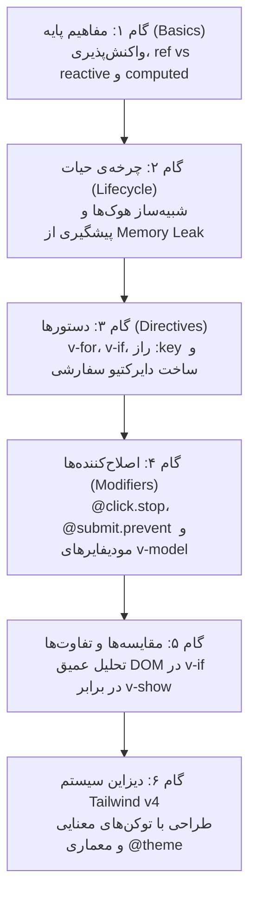

<div align="center" dir="rtl">

# 🌟 کارگاه تعاملی و عمیق یادگیری Vue 3 و Tailwind CSS v4
### Vue 3 Interactive Deep-Dive Workshop & Live Playground

<p align="center">
  <b>یادگیری مفهومی و پایه‌ای Vue 3 با مثال‌های زنده، شبیه‌ساز تصویری چرخه‌ی حیات، حل عملی باگ نشت حافظه (Memory Leak) و سیستم طراحی مدرن Tailwind v4 بدون حفظ کردن کدها!</b>
</p>

[](https://vuejs.org/)
[](https://vite.dev/)
[](https://tailwindcss.com/)
[](https://vitest.dev/)
[](https://opensource.org/licenses/MIT)
[](http://makeapullrequest.com)

<br />

<p align="center">
  <a href="https://mrabbas2007.github.io/learn-vue3-interactive/" target="_blank">
    
  </a>
</p>

[🌐 مشاهده وبسایت زنده (Live Demo)](https://mrabbas2007.github.io/learn-vue3-interactive/) •
[📖 فهرست مطالب](#-فهرست-مطالب) •
[🚀 راه‌اندازی در سیستم محلی](#-راه‌اندازی-پروژه-در-سیستم-محلی)

---

</div>

## 📖 فهرست مطالب
- [معرفی پروژه و هدف آن](#-درباره-پروژه)
- [ویژگی‌های کلیدی و آزمایشگاه‌های تعاملی](#-ویژگیهای-کلیدی-و-آزمایشگاهها)
- [نقشه راه یادگیری در این کارگاه](#-نقشه-راه-یادگیری)
- [پشته فناوری (Tech Stack)](#-پشته-فناوری-tech-stack)
- [ساختار فایل‌ها و معماری پوشه‌ها](#-ساختار-معماری-پروژه)
- [راه‌اندازی پروژه در سیستم محلی](#-راه‌اندازی-پروژه-در-سیستم-محلی)
- [اجرای تست‌ها و ارزیابی کیفیت کد](#-اجرای-تستها-و-لینتر)
- [کلمات کلیدی و تاپیک‌های سئو (SEO Tags)](#-کلمات-کلیدی-و-تگهای-سئو)
- [مشارکت در توسعه (Contributing)](#-مشارکت-در-توسعه)
- [مجوز (License)](#-مجوز)

---

## 🎯 درباره پروژه

بسیاری از دوره‌های آموزشی Vue 3 صرفاً به آموزش حفظی سینتکس‌ها می‌پردازند، بدون اینکه کارآموز متوجه شود **زیر کاپوت فریم‌ورک دقیقاً چه می‌گذرد**. 

این پروژه به عنوان یک **کارگاه آزمایشگاهی تمام‌عیار (Interactive Learning Lab)** طراحی شده تا مفاهیم چالش‌برانگیزی که حتی توسعه‌دهندگان متوسط در آن دچار اشتباه می‌شوند را با **آزمایش‌های زنده دوطرفه**، **نمایش لحظه‌ای RAM در برابر DOM** و **شبیه‌سازهای تصویری** به ساده‌ترین شکل ممکن آموزش دهد.

> [!TIP]
> این مخزن به طور کامل بر اساس آخرین استانداردهای **Vue 3.5 (Composition API)**، ابزار ساخت فوق سریع **Vite 8** و معماری جدید **Tailwind CSS v4** طراحی شده است.

---

## 🧪 ویژگی‌های کلیدی و آزمایشگاه‌ها

### ۱. آزمایشگاه واکنش‌پذیری (Reactivity Under The Hood)
- **اثبات تفاوت RAM و DOM**: بررسی عینی رفتار متغیر معمولی `let` در برابر `ref` با ایزولاسیون کامل از رندرهای ناخواسته.
- **تله Destructure در reactive**: مشاهده مستقیم شکستن شیء Proxy هنگام استخراج خواص با `{ age } = state`.
- **کش هوشمند computed**: اثبات عدم اجرای مجدد محاسبات سنگین تا زمان تغییر متغیرهای وابسته.
- **راز عملکرد دوطرفه v-model**: باز کردن عملکرد معادل دستی `:value` و `@input`.

### ۲. شبیه‌ساز زنده چرخه‌ی حیات (Interactive Lifecycle Visualizer)
- **استعاره صحنه تئاتر**: درک آسان ۴ فاز تولد (Creation)، ورود به صحنه (Mounting)، بازیگری (Updating) و خروج (Unmounting).
- **کنسول وقایع زنده**: ثبت میکروثانیه‌ای اجرای هوک‌ها به همراه بررسی وضعیت دسترسی به درخت DOM واقعی.
- **آزمایشگاه نشت حافظه (Memory Leak Lab)**:
  - شبیه‌سازی زنده اجرای تایمر یتیم در RAM بعد از حذف کامپوننت.
  - اثبات ضرورت غیرقابل انکار پاک‌سازی با `clearInterval` در هوک `onUnmounted`.

### ۳. دایرکتیوها و ساخت Custom Directive
- بررسی رندر شرطی (`v-if`, `v-else-if`, `v-else`) و رفتار واکنش‌گرا.
- تکرار با `v-for` و اثبات علمی چرایی استفاده از **کلیدهای یکتا (`id`)** به جای `index`.
- ساخت یک دایرکتیو سفارشی کامل (`v-highlight`) همراه با پارامترهای پویا، هوک‌های Lifecycle و مودیفایرهای `.hover` و `.big`.

### ۴. تفکیک عمیق اصلاح‌کننده‌ها (Modifiers)
- **اصلاح‌کننده‌های رویداد (Event Modifiers)**: تست مقایسه‌ای نشت رویداد به والد با `@click.stop` و جلوگیری از رفرش صفحه با `@submit.prevent`.
- **اصلاح‌کننده‌های ورودی (v-model Modifiers)**: تست همزمان `.lazy`، `.trim` و تبدیل داده‌های ورودی به اعداد واقعی با `.number`.

### ۵. حل چالش‌های مفهومی (`v-if` vs `v-show`)
- **آزمایشگاه بازسازی حافظه داخلی**: بررسی تفاوت تخریب کامل DOM و پاک شدن State با `v-if` در برابر مخفی‌سازی با `display: none` در `v-show`.
- **بازرس زنده ساختار DOM**: مشاهده وضعیت نودهای HTML و کامنت `<!--v-if-->` در زمان اجرا.

### ۶. سیستم طراحی نوین با Tailwind CSS v4
- پیاده‌سازی متغیرهای طراحی در دایرکتیو جدید `@theme`.
- رنگ‌های معنایی (Semantic Tokens) برای سهولت سفارشی‌سازی تم و دارک‌مود.
- عدم نیاز به فایل‌های حجیم و سنگین `tailwind.config.js`.

### ۷. دارک‌مود واقعی بر پایهٔ توکن‌ها (Themeable By Design)
- کلید تغییر تم در هدر: تم انتخابی در `localStorage` ذخیره و در اولین بار از تنظیم سیستم (`prefers-color-scheme`) خوانده می‌شود.
- تعریف دوبارهٔ توکن‌های معنایی در کلاس `.dark`؛ هیچ کامپوننتی کلاس رنگ سخت‌کدشده ندارد، پس تغییر تم بدون دست‌زدن به مارک‌آپ انجام می‌شود.
- پیاده‌سازی با `@custom-variant dark` در Tailwind v4 (استراتژی کلاس به‌جای مدیا کوئری).

---

## 🗺️ نقشه راه یادگیری



---

## 💻 پشته فناوری (Tech Stack)

| تکنولوژی | نسخه | کاربرد |
| :--- | :--- | :--- |
| **Vue.js** | `v3.5+` | فریم‌ورک اصلی بر پایه Composition API و `<script setup>` |
| **Vite** | `v8.x` | محیط توسعه و باندلر فوق سریع |
| **Tailwind CSS** | `v4.x` | فریم‌ورک مدرن استایل‌دهی با معماری Design Tokens |
| **Vue Router** | `v5.x` | مدیریت ناوبری تک‌صفحه‌ای (SPA) با تاریخچه مرورگر |
| **Lucide Vue** | `v1.x` | مجموعه آیکون‌های برداری مدرن و یکدست |
| **Vitest** | `v4.x` | ابزار اجرای تست‌های واحد کامپوننت‌ها و دموها |
| **Oxlint & ESLint** | `v1.x` | اعتبارسنجی سرعت‌بالای کیفیت کد و قوانین Vue |
| **Fontsource** | `v5.x` | میزبانی محلی فونت‌های وزیرمتن و JetBrains Mono (بدون وابستگی به Google Fonts) |

---

## 📁 ساختار معماری پروژه

```text
├── .github/
│   └── workflows/
│       └── deploy.yml          # اکشن خودکار بیلد و استقرار در GitHub Pages
├── src/
│   ├── assets/
│   │   └── main.css            # تعریف @theme و دیزاین توکن‌های Tailwind v4
│   ├── components/
│   │   ├── common/             # کامپوننت‌های پایه (کارت‌ها، کدها، هدر)
│   │   │   ├── AppHeader.vue
│   │   │   ├── CalloutBox.vue
│   │   │   ├── CodeSnippet.vue
│   │   │   ├── ConceptCard.vue
│   │   │   └── VueParticleOrb.vue
│   │   └── learning/           # آزمایشگاه‌های تعاملی آموزشی
│   │       ├── LifecycleDemoChild.vue
│   │       ├── LifecycleStageVisualizer.vue
│   │       ├── MemoryLeakDemo.vue
│   │       ├── ReactivityComparisonDemo.vue
│   │       └── VIfVsVShowChild.vue
│   ├── composables/
│   │   └── useTheme.js         # مدیریت تم روشن/تاریک + ذخیره در localStorage
│   ├── directives/
│   │   └── highlight.js        # دایرکتیو سفارشی نمونه با چرخه‌ی حیات
│   ├── router/
│   │   └── index.js            # مسیرهای برنامه و کنترل عناوین سئو
│   ├── views/                  # صفحات آموزشی شش‌گانه
│   │   ├── BasicsView.vue
│   │   ├── CompareView.vue
│   │   ├── DirectivesView.vue
│   │   ├── HomeView.vue
│   │   ├── LifecycleView.vue
│   │   ├── ModifiersView.vue
│   │   ├── NotFoundView.vue    # صفحه‌ی 404 برای آدرس‌های نامعتبر
│   │   └── TokensView.vue
│   ├── __tests__/              # تست‌های واحد (کامپوننت، روتر و تم)
│   ├── App.vue
│   └── main.js
├── public/
│   ├── favicon.ico
│   ├── og-image.png            # تصویر ۱۲۰۰x۶۳۰ برای کارت شبکه‌های اجتماعی
│   ├── robots.txt
│   └── sitemap.xml
├── index.html                  # سئو، OpenGraph، داده ساختاریافته و اسکریپت اولیه‌ی تم
├── LICENSE                     # مجوز MIT
├── package.json
└── vite.config.js              # پیکربندی پایه و مسیردهی برای GitHub Pages
```

---

## 🚀 راه‌اندازی پروژه در سیستم محلی

### پیش‌نیازها
- **Node.js**: نسخه `22.18.0` یا بالاتر (پشتیبانی تا Node 24)
- **pnpm**: نسخه `9` یا `10` (پیشنهاد رسمی برای سرعت و کارایی حافظه)

### مراحل نصب و اجرا

۱. ابتدا ریپازیتوری را کلون کنید:
```bash
git clone https://github.com/<YOUR-USERNAME>/<YOUR-REPO-NAME>.git
cd <YOUR-REPO-NAME>
```

۲. وابستگی‌ها را با `pnpm` نصب کنید:
```bash
pnpm install
```

۳. سرور توسعه محلی را اجرا کنید:
```bash
pnpm dev
```
مرورگر خود را باز کرده و به آدرس `http://localhost:5173` بروید.

---

## 🧪 اجرای تست‌ها و لینتر

تمامی تست‌های واحد مربوط به تعاملات آزمایشگاهی، هوک‌ها و دایرکتیوها با **Vitest** نوشته شده‌اند:

```bash
# اجرای تمامی تست‌های واحد
pnpm test:unit --run

# بررسی کیفیت کد و استانداردها با Oxlint و ESLint
pnpm lint

# بیلد نهایی برای محیط Production
pnpm build
```

---

## 🏷️ کلمات کلیدی و تگ‌های سئو

برای دریافت حداکثر بازدید و ستاره (Star) در گیت‌هاب، پیشنهاد می‌شود تگ‌های زیر را در بخش **Topics** ریپازیتوری وارد نمایید:

`vue3` • `vue-router` • `tailwindcss-v4` • `composition-api` • `interactive-tutorial` • `persian` • `farsi` • `reactivity` • `lifecycle-hooks` • `memory-leak` • `frontend-roadmap` • `vite8` • `web-development`

---

## 🤝 مشارکت در توسعه (Contributing)

مشارکت‌ها باعث بهتر شدن جامعه متن‌باز می‌شوند! اگر تمایل به بهبود توضیحات، افزودن مثال‌های تعاملی جدید یا رفع ایراد دارید:

۱. مخزن را فورک (Fork) کنید.
۲. یک شاخه برای قابلیت جدید بسازید (`git checkout -b feature/NewInteractiveDemo`).
۳. تغییرات را کامیت کنید (`git commit -m 'feat: Add new reactivity lab'`).
۴. به شاخه خود پوش کنید (`git push origin feature/NewInteractiveDemo`).
۵. یک **Pull Request** ارسال کنید.

---

## 📄 مجوز (License)

این پروژه تحت مجوز [MIT](LICENSE) به صورت کاملاً متن‌باز و رایگان برای استفاده جامعه توسعه‌دهندگان منتشر شده است.
